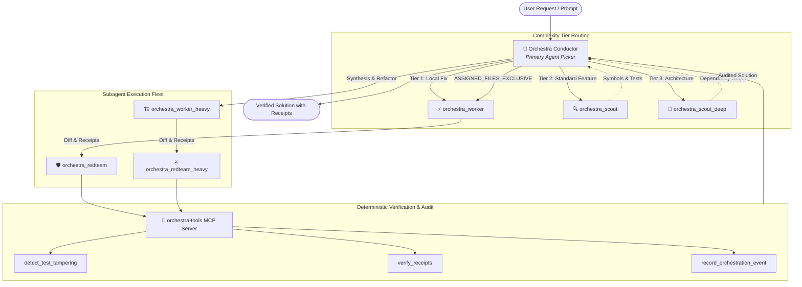

# Antigravity Orchestra

<p align="center">
  
</p>

<p align="center">
  <strong>Model-Agnostic Conductor Plugin & Subagent Fleet for Google Antigravity</strong>
</p>

<p align="center">
  <a href="https://github.com/mohan-the-octocat/antigravity-orchestra/actions"></a>
  <a href="https://github.com/mohan-the-octocat/antigravity-orchestra/blob/main/LICENSE"></a>
  <a href="https://github.com/mohan-the-octocat/antigravity-orchestra/releases"></a>
  
  
</p>

---

## Overview

**Antigravity Orchestra** is a model-agnostic conductor plugin designed for **Google Antigravity**. 

Orchestra separates **high-value architectural reasoning** from **mechanical software execution**:
- The **Conductor Agent (`orchestra`)** remains laser-focused on system architecture, strategic trade-offs, planning, and coordination.
- Mechanical tasks—broad codebase exploration, symbol searches, test execution, repetitive code modifications, and diff reviews—are delegated to isolated subagents (`orchestra_scout`, `orchestra_worker`, and `orchestra_redteam`).

Regardless of whether your primary session runs on **Gemini 1.5/2.0/3.8 Pro/Flash**, **Claude 3.5/3.7 Sonnet**, **Claude Opus**, or other models, Orchestra adapts dynamically to preserve reasoning context and enforce empirical verification.

---

## Key Capabilities

- 🎼 **Selectable Custom Agent**: Registers `orchestra` directly in the Antigravity agent picker dropdown, with complete subagent fleet support.
- 🎯 **Three Complexity Tiers**: Automatically routes tasks from Tier 1 (surgical single-file fixes) to Tier 2 (standard multi-file features) and Tier 3 (complex architectural refactoring).
- 📋 **Zero-Decision Planning (`/orchestra-plan`)**: Enforces the Zero-Decision Rule via Heilmeier scoping, semantic split drafting (Zone A/B), and dual Goldfish critics.
- 🛡️ **Test Anti-Tampering Engine (`/orchestra-verify`)**: Scans git diffs to detect deleted assertions, commented-out tests, and compiler/linter suppression directives (`noqa`, `eslint-disable`, `@Suppress`, `@unittest.skip`).
- 🧾 **Verifiable Receipts Contract**: Eliminates hallucinated test successes by demanding physical receipts files containing verbatim commands, outputs, and exit code 0.
- 🔌 **Built-in Model Context Protocol (MCP)**: Bundles the `orchestra-tools` stdio MCP server for live tampering audits, receipts verification, context monitoring, and local event telemetry.
- ⚡ **Zero External Dependencies**: Core plugin and MCP server run on Python 3 standard library without needing external packages.

---

## Architecture



---

## Subagent Fleet

Orchestra organizes specialized subagents across two execution profiles:

| Agent Name | Role | Model Tier | Tools | Purpose |
| :--- | :--- | :--- | :--- | :--- |
| **`orchestra`** | Conductor | Selected in UI | Full + Subagents | Strategic planning, tier routing, coordination, final audit |
| **`orchestra_scout`** | Investigator | `flash` | Read-only | Rapid codebase exploration, symbol lookups, test discovery |
| **`orchestra_scout_deep`** | Deep Investigator | `pro` | Read-only | Multi-package dependency mapping and system-wide design analysis |
| **`orchestra_worker`** | Implementer | `flash` | Full Coding & Tests | Bounded code edits in `ASSIGNED_FILES_EXCLUSIVE`, test execution |
| **`orchestra_worker_heavy`**| Heavy Implementer| `pro` | Full Coding & Tests | Multi-file synthesis, complex refactoring, dead-end escalation |
| **`orchestra_redteam`** | Reviewer | `flash` | Read & Patch | Fresh-context diff review, test integrity audit, in-place fixes |
| **`orchestra_redteam_heavy`**| Invariant Auditor| `pro` | Read & Patch | Adversarial contract stress-testing and deep invariant audits |

---

## Complexity Tiers

### Tier 1: Surgical Edits
- **Scope**: Single-file bug fixes, typos, small assertion updates.
- **Protocol**:
  1. Conductor dispatches a single `orchestra_worker` in `Workspace: 'inherit'`.
  2. Worker modifies code, executes the test suite, and outputs the structured return header.
  3. Conductor audits the diff and delivers the verified fix. No separate planning or review pass needed.

### Tier 2: Standard Feature / Bug Fix
- **Scope**: Multi-file changes with clear boundaries, new API endpoints, refactoring.
- **Protocol**:
  1. **Scouting**: `orchestra_scout` locates symbols, callers, and existing tests.
  2. **Decision Spine**: Conductor writes a terse architectural spine (10–15 lines).
  3. **Implementation**: `orchestra_worker` implements changes strictly within `ASSIGNED_FILES_EXCLUSIVE`.
  4. **Adversarial Review**: `orchestra_redteam` audits the diff in fresh context for stubs, swallowed errors, and test tampering.
  5. **Conductor Audit**: Conductor reviews the verified diff and receipts before presenting the completed task.

### Tier 3: Complex Architectural Refactoring
- **Scope**: High-risk migrations, cross-package interface overhauls, ambiguous designs.
- **Protocol**:
  1. **Deep Scouting**: `orchestra_scout_deep` maps end-to-end call graphs and data flows.
  2. **Competing Branches (Optional)**: Dispatch parallel workers in isolated branch workspaces (`Workspace: 'branch'`) to prototype competing approaches (minimalist vs. defensive).
  3. **Architectural Synthesis**: Conductor unifies the design into an authoritative specification.
  4. **Heavy Implementation**: `orchestra_worker_heavy` executes the synthesized refactor.
  5. **Deep Invariant Review**: `orchestra_redteam_heavy` stress-tests boundary conditions and concurrency safety.

---

## Return Header & Receipts Contract

Every worker and reviewer subagent concludes execution with a standardized header:

```text
STATUS: DONE | DONE_WITH_CONCERNS | NEEDS_CONTEXT | BLOCKED | HANDOFF
MODIFIED_FILES: src/auth/interceptor.py, tests/test_auth.py
VERIFY_RECEIPT: PASSED | FAILED | NOT_RUN
RECEIPTS_FILE: /path/to/scratch/receipts.txt
HANDOFF_FILE: none
```

### Receipts File Format

When `VERIFY_RECEIPT: PASSED` is claimed, `RECEIPTS_FILE` must contain:
1. The exact command executed in a ````bash` block.
2. The exit code (`Exit code: 0`).
3. An `Output:` header followed by the verbatim terminal output.

```markdown
# Verification Receipt

```bash
pytest tests/test_auth.py -v
```

Exit code: 0

Output:
```text
tests/test_auth.py::test_interceptor_with_call_context PASSED [100%]
==== 1 passed in 0.28s ====
```
```

---

## Test Tampering Detection

To prevent subagents from faking green builds when hitting unexpected test failures, Orchestra's anti-tampering engine scans git diffs on test files for:

1. **Deleted Assertions**: Removes assertions (`assert`, `assertEquals`, `expect(`, `require.Equal`, `t.Error`, etc.).
2. **Commented-Out Assertions**: Turning failing assertions into comments (`# assert ...`, `// expect(...)`).
3. **Suppression Annotations**:
   - Python: `# noqa`, `# pylint: disable`, `# type: ignore`, `@unittest.skip`, `@pytest.mark.skip`
   - TypeScript / JavaScript: `// eslint-disable`, `// @ts-ignore`, `// @ts-nocheck`, `// @ts-expect-error`
   - Go: `// go:build ignore`
   - Java / Kotlin: `@Suppress`, `@SuppressWarnings`

Audit diffs instantly via CLI or MCP tool:
```bash
python3 scripts/detect_test_tampering.py --workspace-dir .
```

---

## Slash Commands

| Command | Skill | Description |
| :--- | :--- | :--- |
| `/orchestra <task>` | `orchestra` | Run the main conductor orchestration on any task. |
| `/orchestra-plan <task>` | `orchestra_plan` | Execute the 4-phase architectural planning protocol. |
| `/orchestra-verify` | `orchestra_verify` | Audit the current workspace for test tampering and receipts. |

---

## Installation

### Method 1: Automated Installer (Recommended)

Run the one-line install command:

```bash
git clone https://github.com/mohan-the-octocat/antigravity-orchestra.git
cd antigravity-orchestra
./install.sh
```

Or run via Python directly:
```bash
python3 scripts/install.py --scope=global
```

### Method 2: Workspace-Local Installation

To install Orchestra exclusively for a single project/repository:

```bash
./install.sh --scope=workspace --project-dir=/path/to/my-project
```

### Verification & Usage

1. Restart or reload your Antigravity environment.
2. Open the **Agent dropdown picker** in Antigravity: `orchestra` will be visible and selectable.
3. Select `orchestra` or type `/orchestra` in the chat prompt to start an orchestrated workflow.

To uninstall cleanly at any time:
```bash
./install.sh --uninstall
```

---

## MCP Server Configuration

Orchestra bundles a native stdio MCP server (`mcp_config.json`). It exposes four tools:

- `detect_test_tampering`: Audits git diffs for modified or deleted assertions.
- `verify_receipts`: Reconciles test command output and exit codes.
- `get_orchestration_status`: Evaluates context token usage against the 250,000-token handoff threshold.
- `record_orchestration_event`: Appends milestone events to `~/.gemini/antigravity/orchestra_telemetry.jsonl`.

---

## Running Tests

Orchestra includes an automated test suite with 100% standard library testing:

```bash
python3 -m unittest discover -s tests -v
```

All 29 tests validate manifest schemas, agent YAML frontmatter, skills markdown structure, tampering detection algorithms, receipts parsers, and stdio MCP protocol handlers.

---

## License

Licensed under the [Apache License, Version 2.0](LICENSE).
Copyright © 2026 Mohan Sridharan.
